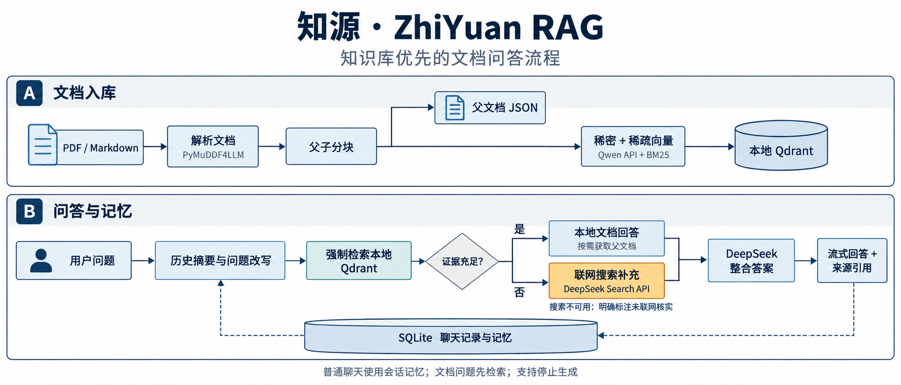
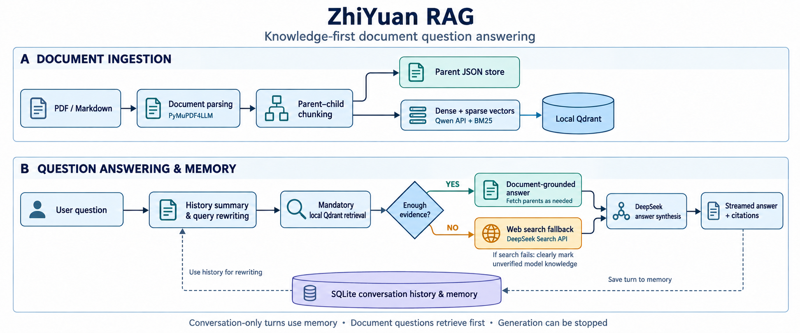
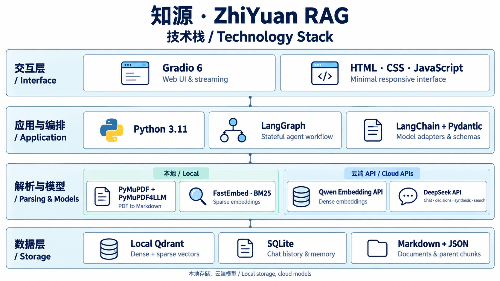

<p align="center"></p>

<h1 align="center">knowva</h1>

<p align="center">先查文档，再补充互联网。让回答有来源，让对话有记忆。</p>

knowva 是一个本地运行的中文文档问答应用：上传 PDF / Markdown，构建知识库，并通过对话查询资料。文档问题首先执行本地混合检索，资料不足时联网补充，并展示实际搜索到的网站来源。

基于 [Giovanni Pasqualino 的 agentic-rag-for-dummies](https://github.com/GiovanniPasq/agentic-rag-for-dummies) 改造，保留原作者署名，继续使用 [MIT License](LICENSE)。

**当前版本：knowva v0.2.0 预览版（2026-10-24）**，Git 标签为 `v0.2.0`；品牌、独立账号和资源管理更新见 [CHANGELOG.md](CHANGELOG.md)。版本号属于本复刻项目，与上游版本号独立。此前初始预览版标签 `zhiyuan-v0.1.0` 和已有上游标签继续保留。网站品牌统一为 `knowva`（原名知源）；GitHub 仓库暂保留名称 `agentic-rag-zhiyuan`。

此预览版的发布不会自动更新线上服务器。升级前请按 [部署说明](DEPLOYMENT.md) 备份数据并配置正式 Turnstile；没有默认管理员账号或密码，需在可信服务器终端为已注册账号授权。

这是独立维护的学习与二次开发项目，核心架构源自上游；本项目不代表原作者或相关模型服务商，未获其官方背书。当前适合个人本地使用和部署测试，支持公开游客首页、用户名注册和登录，知识库与聊天记录按账号隔离。已提供服务端用量限制、管理员命令行/API 和备份校验工具，尚无付费系统或完整可视化管理后台。已实现内容见下文，版本记录见 [CHANGELOG.md](CHANGELOG.md)，使用前请阅读 [免责声明](DISCLAIMER.md) 和 [安全说明](SECURITY.md)。

## 功能

- **知识库优先**：程序强制执行首次本地检索，模型不能跳过；检索异常会提示重试，不会被当作“无资料”转去联网。
- **混合检索与父子分块**：Qwen API 稠密向量 + FastEmbed BM25 稀疏向量，由本地 Qdrant 检索，按需获取父文档补充上下文。
- **联网补充与引用**：调用 DeepSeek 搜索接口，引用链接以实际搜索结果为准；搜索不可用时标注“未能联网核实”。
- **持久聊天记忆**：SQLite 保存记录与记忆，支持历史切换、重启后继续提问、独立会话及删除对话。
- **真实入库状态**：展示解析、切分、索引阶段及实际写入段数，不用文件序号冒充进度；支持失败重试和选择删除文档。
- **极简中文界面**：手机布局、流式回答、复制回答、Enter 发送、Shift+Enter 换行、生成中随时停止。
- **处理过程可见**：回答上方展示可折叠的执行摘要，不输出模型内部推理原文。

## 快速开始

### 环境

使用 **Python 3.11 及以上版本**。在 Windows PowerShell 中：

```powershell
git clone https://github.com/baihuchen554-cell/agentic-rag-zhiyuan.git
cd agentic-rag-zhiyuan
python -m venv .venv
.\.venv\Scripts\python.exe -m pip install -r requirements.txt
```

已有项目直接进入当前根目录即可，本地文件夹名称不影响应用名称。

### 配置 API

配置文件是 **`project/.env`**。首次使用时复制模板，已有配置不会覆盖：

```powershell
if (-not (Test-Path project/.env)) {
    Copy-Item project/.env.example project/.env
}
```

编辑 `project/.env`：

```dotenv
DASHSCOPE_API_KEY=你的百炼密钥
DEEPSEEK_API_KEY=你的DeepSeek密钥
EMBEDDING_BASE_URL=https://dashscope.aliyuncs.com/compatible-mode/v1
DEEPSEEK_BASE_URL=https://api.deepseek.com
WEB_SEARCH_ENABLED=true
```

系统环境变量优先于 `.env`。模型名称、维度和分块参数在 [project/config.py](project/config.py)。

### 网站品牌与账号

网站名称、标题和 SVG 标志路径集中在 `project/config.py` 的 `APP_NAME`、`APP_TITLE`、`APP_LOGO_PATH`。侧栏和浏览器图标使用维护者制作的 `assets/logo.svg`。

首页允许游客直接浏览。使用问答、知识库或上传文件时需注册或登录。注册只需用户名、姓名、密码和 Cloudflare Turnstile 人机验证，无需绑定手机号或邮箱。服务器核验验证结果、域名、操作与浏览器请求绑定，接口限制请求频率。部署前需在 `project/.env` 配置正式 Turnstile 密钥，详见 [部署说明](DEPLOYMENT.md)；未配置时不允许登录注册。密码至少 10 个字符，组合使用字母、数字或符号；密码以带随机盐的 scrypt 哈希保存。会话使用 HttpOnly、SameSite Cookie，经 HTTPS 访问时启用 Secure；退出会撤销当前会话。

点击侧栏底部的账号打开设置，可修改姓名、上传或移除头像，以及验证当前密码后更换密码。头像由服务器裁切并重新编码，更新密码会撤销其他登录会话。浏览器标签名称统一为 `knowva`。

注册成功会提供一次性的账号恢复码。请下载并妥善保管；忘记密码时可用它重设密码，重设后撤销全部旧会话并轮换恢复码。没有绑定手机或邮箱，丢失密码和恢复码后无法通过它们找回账号。旧版站点共用账号配置 `WEB_AUTH_*` 已停止使用，不会自动转换为个人账号。

账号数据库位于 `account_data/accounts.sqlite3`，每个账号的数据位于 `user_data/<服务端生成的用户ID>/`。新账号的知识库和聊天记录初始为空。旧版共享的 `knowledge_base/`、`chat_history/` 保留在原地，不会自动分配给任何新账号。不要手工将旧数据复制给所有用户。

后端每次执行功能时都会重新校验会话，并检查队列会话和上传文件的归属；用户目录不对外作为静态文件公开。模型 API 和 CPU 资源仍共用，服务端按账号限制问答次数、上传流量和向量处理量；Gradio 与独立业务接口共用配额与任务容量控制。Turnstile 不替代服务端鉴权、限流和资源管理，也不保证阻止全部自动化攻击。

账号设置中的“使用额度”可查看今日用量和文档/存储预算。默认每日 30 次问答、50 MB 上传流量、50 万向量处理字符；每批最多 3 个文件，单个 10 MB，PDF 最多 100 页，知识库最多 30 个文档，工作目录预算 100 MB。已接受的尝试计入额度，停止或失败不退回已消耗的部分；这些不是模型账单的 Token 或金额限额。

默认允许两个账号各执行一个任务，同时仅进行一项文档写入任务。BM25 编码器跨账号共享，知识库数据保持分离。工作空间缓存最多 3 个，闲置 10 分钟或驻留满 1 小时后，在没有任务和回调使用时回收内存；磁盘数据保留，下次访问会重新加载。停止中的网络请求仍占任务名额，直到实际退出。

前端仍保留 Gradio；新增 `/api/` 业务接口，便于逐步拆出独立前端，见 [API 说明](API.md)。配置、管理员授权、健康检查、备份与恢复演练见 [运维说明](OPERATIONS.md)。

首次使用问答或知识库时才初始化模型；首页和注册不需要下载 BM25。需要镜像时，可在 `.env` 中设置 `HF_ENDPOINT=https://hf-mirror.com`，通过 `FASTEMBED_CACHE_PATH` 指定缓存目录。

本地更新代码不要覆盖服务器的 `.env`、`account_data/` 和 `user_data/`。数据库升级前先停止服务并备份；数据目录和旧共享数据均在 `.gitignore` 中。现有 `knowva.service` 仍可用原命令运行 `project/app.py`，入口现使用 FastAPI/Uvicorn 承载公开首页和账号接口，无需更改 Nginx 转发端口。

### 启动和停止

```powershell
.\.venv\Scripts\python.exe project\app.py
```

打开终端显示的地址，通常是 **http://127.0.0.1:7860**。首次使用知识库或问答功能时可能需要下载 BM25 模型。

请在自己的终端以前台方式运行，停止时在同一终端按 **Ctrl+C**。本地 Qdrant 的同一份知识库只能由一个应用实例打开；修改代码后重启应用。

<details>
<summary>Linux / macOS</summary>

```bash
python3 -m venv .venv
.venv/bin/python -m pip install -r requirements.txt
# 首次使用才复制模板，已有 project/.env 则跳过
cp -n project/.env.example project/.env
# 编辑 project/.env 后启动
.venv/bin/python project/app.py
```

</details>

## 使用

### 文档入库

1. 点击“知识库”，选择或拖入 PDF / Markdown 文件。
2. 上传结束后点击“开始入库”。
3. 状态卡依次显示“解析文档 → 文本切分 → 建立索引”。解析耗时未知时不显示虚假百分比；索引按成功写入的文本段计数。
4. 显示“入库完成”后即可提问；失败时保留所选文件，点击“重试入库”重试。
5. 已入库列表中勾选文档，点击“删除所选”并确认，可同时删除文档与对应索引。

按不含扩展名的名称判重，例如 `手册.pdf` 和 `手册.md` 视为同一文档。更新文件时先删除旧文档，再上传新版本。原始 PDF 不作为长期归档保存，请自行保留原件。

### 聊天与记忆

- **Enter** 发送，**Shift+Enter** 换行。
- 生成时按钮切换为停止方块；点击后停止页面输出，保留已有回答，并可继续提问。已发出的远程请求可能仍由服务商处理，迟到结果不会覆盖新回答。
- 文档问题先检索知识库，资料不足时联网；问候、记录个人偏好和回顾本次聊天使用会话记忆。
- 历史列表可恢复旧会话；“删除当前对话”确认后同时移除聊天记录与对应记忆。
- 回答上方的“处理过程”展示真实执行阶段和来源摘要，完成后自动折叠，不会作为用户事实传回模型。

## 工作流程



<details>
<summary>English workflow</summary>



</details>

实际路径：

```text
问题 + 会话记忆 → 历史摘要与问题改写
  ├─ 普通聊天 → 根据记忆回复
  └─ 文档问答 → 强制本地混合检索
       ├─ 证据充足 → 文档回答，按需获取父文档
       └─ 证据不足 → 联网搜索；不可用时标注未核实
     → DeepSeek 整合答案与来源 → 流式显示 → 保存记忆
```

不清晰的问题会先请求澄清；多个独立子问题分别检索后再整合。工作流包含检索上下文压缩和工具调用次数限制。

## 技术栈与配置



| 用途 | 当前配置 | 位置 |
| --- | --- | --- |
| 对话、改写、检索决策、整合 | DeepSeek API：`deepseek-flash` | 云端 |
| 稠密向量 | `qwen3.7-text-embedding-flash`，1024 维 | 百炼 API |
| 稀疏向量 | `Qdrant/bm25`，FastEmbed | 本地 |
| 联网检索 | DeepSeek `/v1/tools/search` | 云端 |
| 向量存储 | Qdrant 本地模式 | 本机 |
| 聊天记录与记忆 | SQLite | 本机 |
| 界面与编排 | Gradio 6、LangGraph、LangChain、Pydantic | Python |
| PDF 解析 | PyMuPDF、PyMuPDF4LLM | 本机 |

| 参数 | 默认值 | 说明 |
| --- | --- | --- |
| `EMBEDDING_BATCH_SIZE` | 20 | 每批向量化及写入的段数 |
| `CHILD_CHUNK_SIZE` / `CHILD_CHUNK_OVERLAP` | 500 / 100 | 子块字符数与重叠量 |
| `MIN_PARENT_SIZE` / `MAX_PARENT_SIZE` | 2000 / 4000 | 父文档块长度范围 |
| `DEFAULT_RETRIEVAL_K` / `RETRIEVAL_SCORE_THRESHOLD` | 7 / 0.4 | 召回数量与得分阈值 |
| `MAIN_HISTORY_MESSAGES_TO_KEEP` | 12 | 工作流近期消息窗口，包含本轮消息 |
| `MODEL_API_TIMEOUT` | 120 秒 | 模型请求超时 |
| `MAX_TOOL_CALLS` / `MAX_ITERATIONS` | 8 / 10 | 单个子问题执行预算 |
| `WEB_SEARCH_ENABLED` | true | 可在 `.env` 中关闭联网补充 |

更换稠密向量模型或维度后会使用新的知识库目录，需要重新入库；聊天记录独立保存，不随模型更换而清空。

图表使用内置 **GPT Image** 生成，采用白底科研风。提示词和修订记录见 [assets/image-prompts.md](assets/image-prompts.md)。

## 项目结构

```text
assets/
  logo.svg                自定义品牌标志
  icons/                  界面 SVG 图标
  workflow_zh.png         中文项目流程图
  workflow_en.png         英文项目流程图
  tech_stack.png          中英双语技术栈图
  image-prompts.md        图表提示词与生成记录
project/
  app.py                  程序入口
  account_server.py       账号接口、同源校验与 Gradio 挂载
  business_api.py         个人业务接口、管理员接口与健康检查
  manage.py               可信终端维护与备份入口
  config.py               名称、模型、路径和参数
  .env.example            API 配置模板
  core/                   文档、聊天、记忆、联网和执行状态
  db/                     Qdrant 与父文档存储
  rag_agent/              LangGraph 工作流、路由和提示词
  ui/                     Gradio 页面、样式、交互和中文翻译
  document_chunker.py     父子分块
  utils.py                PDF 转换、Token 估算
tests/                    离线回归测试
account_data/             账号、会话、角色、头像、用量与审计（运行时生成）
user_data/<用户ID>/         个人知识库与聊天记录（运行时生成）
  knowledge_base/<模型>_<维度>/
  chat_history/
knowledge_base/            旧版共享数据，保留但不自动导入账号
chat_history/             旧版共享聊天，保留但不对游客公开
requirements.txt          锁定的运行依赖
LICENSE                   MIT 许可与原作者署名
```

资源统一放在 `assets/`，不依赖开发者电脑上的临时图片。账号版使用 `user_data/<用户ID>/` 中的个人存储；根目录已有的旧版 `knowledge_base/`、`chat_history/` 和 `qdrant_db/` 保留，不会自动分配给注册用户。

## 数据与备份

- 账号、会话、角色、头像、用量与审计：`account_data/accounts.sqlite3`。
- 个人 Markdown、父块 JSON 和向量索引：`user_data/<用户ID>/knowledge_base/<模型>_<维度>/`。
- 个人聊天记录与记忆：`user_data/<用户ID>/chat_history/conversations.sqlite3`，与向量索引相互独立。
- 备份前停止整个应用，使用 `project/manage.py backup` 创建包含配置、账号库和全部个人数据的私有备份，再用 `verify-backup` 校验。完整命令和恢复演练见 [运维说明](OPERATIONS.md)；不要只备份旧共享目录。
- 如仍保留旧版 `knowledge_base/`、`chat_history/`、`qdrant_db/`，备份工具默认一并收录。Nginx、systemd 与 HTTPS 证书位于项目外，需另外安全备份。
- `project/.env` 单独妥善保管，勿提交版本库。运行数据与密钥均已列入 `.gitignore`。
- **本地存储不代表完全离线**：文档文本会发送到向量 API；召回内容、问题和必要的会话上下文会发送到 DeepSeek；联网补充时向搜索接口发送检索问题。

## 常见问题

| 现象 | 处理方式 |
| --- | --- |
| 缺少 API 配置 | 检查 `project/.env` 中两个密钥，以及终端环境变量是否覆盖它们。 |
| 知识库被另一实例占用 | 在旧应用所在终端按 Ctrl+C，确认退出后再启动。不要删除数据库锁文件。 |
| 当前终端 Ctrl+C 无效 | 若终端已回到提示符，它没有运行服务；请在实际启动旧实例的终端停止。 |
| 上传后尚未入库 | 上传只传输文件；结束后点击“开始入库”，查看下方状态卡。 |
| 长时间停在解析 | 检查 PDF 页数、扫描内容和复杂表格；解析速度与向量 API 无关。可先转换为 Markdown 再上传。 |
| 停在建立索引 | 检查向量接口网络和限流；仅在每批写入成功后增加段数。 |
| 同名文件无法更新 | 先删除旧文档及索引，再上传新版本。 |
| 联网回答没有来源 | 搜索未返回可用网页时会标注未联网核实，不把模型生成的网址当作已检索出处。 |

## 开发检查

```powershell
.\.venv\Scripts\python.exe -m unittest discover -s tests -v
.\.venv\Scripts\python.exe -m compileall -q project tests
.\.venv\Scripts\python.exe -m pip check
```

测试使用临时数据、测试数据库和模拟接口，覆盖知识库优先、来源校验、记忆恢复、会话删除、停止生成、分批入库与失败回滚、文档删除、PDF 转换、账号隔离、权限撤销、资源限额、业务接口及备份校验，不调用真实付费模型，不修改现有知识库。

v0.2.0 离线回归共 125 项：124 项通过，1 项因 Windows 符号链接权限限制跳过。桌面与 390 px 手机页面已检查上传、问答、额度更新、超额拒绝和账号数据隔离；这些检查不代替正式域名的 Turnstile 验证或服务器压力测试。

## 致谢与许可

原项目：[agentic-rag-for-dummies](https://github.com/GiovanniPasq/agentic-rag-for-dummies)，作者 **Giovanni Pasqualino**，Copyright © 2025。

本项目在原实现基础上加入中文界面、云端模型接口、知识库优先检索、持久会话记忆、联网来源校验、可中止流式生成和分阶段入库状态，整理为“knowva”。2026 年新增修改由 ZhiYuan RAG contributors 贡献。

继续采用 MIT 许可，原始版权声明与许可条款完整保留在 [LICENSE](LICENSE)。第三方依赖和服务遵循各自的许可及使用条款。

代码的 MIT 许可不代表第三方依赖、模型、字体或用户文档均适用 MIT；分发或商用时应另行核实各自的许可和使用条件。软件按现状提供，AI 回答及其引用需要使用者自行核验，详细说明见 [DISCLAIMER.md](DISCLAIMER.md)。
